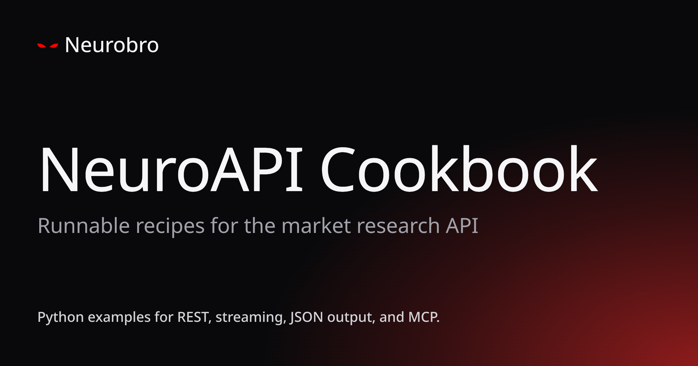

<p align="center">
  
</p>

<h1 align="center">NeuroAPI Cookbook</h1>

<p align="center">
  Runnable Python recipes for <a href="https://neuroapi.neurobro.ai">NeuroAPI</a>, the crypto and financial market research API by Neurobro.
</p>

<p align="center">
  <a href="https://neuroapi.neurobro.ai/docs"></a>
  
  <a href="LICENSE"></a>
</p>

---

NeuroAPI answers research questions about crypto, stocks, forex, commodities, and macro. Ask about any coin, stock, or macro trend and get a researched answer, streamed or as validated JSON. Each recipe here covers one production pattern, runs from a terminal, and is short enough to copy into your own app.

## The API in one minute

| What | How |
| --- | --- |
| Check your key | `GET /api/v1/health` is free and never debits your quota. |
| Ask a question | `POST /api/v1/agent/ask` returns one JSON response, or a Server-Sent Events stream with `stream: true`. |
| Authenticate | Send your key in the `X-API-Key` header. |
| Keep context | You own the conversation: resend earlier turns in `message_history`. |
| Shape the answer | `system_prompt` adds your instructions. `output_schema` (a JSON Schema, non-streaming only) returns a validated object in `output`. |
| Pick the depth | `mode` is `fast` (1 unit), `smart` (2 units, the default), or `max` (8 units, Pro and Enterprise). |
| Know the cost | `usage.cost_units` on each successful response is what that call debited. |
| Use it from an agent | The same research is the MCP tool `ask_neuroapi`. |

## Plans

Every plan includes REST, streaming, JSON output, and the MCP server.

| Plan | Price | Monthly quota | Modes |
| --- | --- | --- | --- |
| Starter | $49 / month | 10,000 cost units | `fast`, `smart` |
| Pro | $299 / month | 100,000 cost units | `fast`, `smart`, `max` |
| Enterprise | Custom | from 1,000,000 cost units | `fast`, `smart`, `max` |

Rate limits, key caps, and what counts against your quota are on the [pricing page](https://neuroapi.neurobro.ai/docs/pricing).

## Quickstart

1. Create an API key in the [NeuroAPI dashboard](https://neuroapi.neurobro.ai/). The key needs an active plan.
2. Copy `.env.example` to `.env` and set `NEUROAPI_KEY`.
3. Install the dependencies:

   ```bash
   python3 -m venv .venv
   source .venv/bin/activate
   pip install -r requirements.txt
   ```

   Or, with `uv`:

   ```bash
   uv sync
   ```

4. Run the first recipe:

   ```bash
   python3 examples/01_getting_started.py
   ```

## Recipes

| Recipe | What you build |
| --- | --- |
| [01_getting_started.py](examples/01_getting_started.py) | Verify a key with `/health`, make one `/agent/ask` call, and read `usage` and `X-Request-Id`. |
| [02_multi_turn_research_chat.py](examples/02_multi_turn_research_chat.py) | A stateless research chat that resends earlier turns in `message_history`. |
| [03_streaming_sse.py](examples/03_streaming_sse.py) | Stream an answer over Server-Sent Events and print chunks as they arrive. |
| [04_resilient_client.py](examples/04_resilient_client.py) | Retry `429` and `503` with `Retry-After`, send idempotency keys, and handle structured errors. |
| [05_structured_market_report.py](examples/05_structured_market_report.py) | Ask for constrained JSON and validate it with Pydantic before using it downstream. |
| [06_scheduled_signal_to_mt5.py](examples/06_scheduled_signal_to_mt5.py) | Run on a CET schedule, combine `system_prompt` and `output_schema` into a validated trade signal, and pass it to a MetaTrader 5 (Fusion Markets) placeholder. |
| [07_fast_and_smart.py](examples/07_fast_and_smart.py) | Send one prompt to `mode=fast` and `mode=smart` and compare the answers. |
| [08_output_schema.py](examples/08_output_schema.py) | Pass a JSON Schema as `output_schema` and validate `output` with Pydantic. |
| [mcp/](examples/mcp/README.md) | Claude Code, Cursor, and VS Code configs for the remote MCP server. |

[examples/README.md](examples/README.md) has usage notes and ideas for extending each recipe.

## Use it from your AI agent (MCP)

Point any MCP client at the remote server. It speaks Streamable HTTP and exposes one tool, `ask_neuroapi`, which takes the same fields as a non-streaming `POST /agent/ask`: `prompt`, plus optional `mode`, `message_history`, `system_prompt`, and `output_schema`.

```text
https://api.neurobro.ai/api/v1/mcp
```

Send your key in the `X-API-Key` header. On this endpoint only, `Authorization: Bearer` also works for clients with just a token field. Never put the key in the URL.

| Client | Setup |
| --- | --- |
| Claude Code | `claude mcp add --transport http neuroapi https://api.neurobro.ai/api/v1/mcp --header "X-API-Key: $NEUROAPI_KEY"`, or [claude-code.mcp.json](examples/mcp/claude-code.mcp.json) as `.mcp.json`. |
| Cursor | [cursor.mcp.json](examples/mcp/cursor.mcp.json) as `~/.cursor/mcp.json` or `.cursor/mcp.json`. |
| VS Code | [vscode.mcp.json](examples/mcp/vscode.mcp.json) as `.vscode/mcp.json`. |

Claude Desktop and other clients: see [Connect a client](https://neuroapi.neurobro.ai/docs/mcp/clients). For ready-made agent skills, see [neurobro-skills](https://github.com/axioma-ai-labs/neurobro-skills).

## Configuration

Every recipe reads these environment variables:

| Variable | Default | Description |
| --- | --- | --- |
| `NEUROAPI_KEY` | required | Your API key from the NeuroAPI dashboard. |
| `NEUROAPI_BASE_URL` | `https://api.neurobro.ai/api/v1` | Override for staging, local development, or tests. |

The dashboard shows the full key once. Keep it in `.env` or a secret manager, never in notebooks, scripts, issues, or commits.

## Docs

- [NeuroAPI docs](https://neuroapi.neurobro.ai/docs) and [quickstart](https://neuroapi.neurobro.ai/docs/quickstart)
- Guides: [authentication](https://neuroapi.neurobro.ai/docs/guides/authentication), [rate limits](https://neuroapi.neurobro.ai/docs/guides/rate-limits), [billing](https://neuroapi.neurobro.ai/docs/guides/billing), [errors](https://neuroapi.neurobro.ai/docs/guides/errors), [idempotency](https://neuroapi.neurobro.ai/docs/guides/idempotency)
- [API reference](https://neuroapi.neurobro.ai/docs/api) and [pricing](https://neuroapi.neurobro.ai/docs/pricing)
- [MCP server](https://neuroapi.neurobro.ai/docs/mcp) and [MCP clients](https://neuroapi.neurobro.ai/docs/mcp/clients)

NeuroAPI answers are AI research, not financial advice. They can be wrong, and you decide what to do with them.

## Contributing

See [CONTRIBUTING.md](CONTRIBUTING.md). A new recipe should be self-contained, about financial markets, and safe to run with a real API key.

## License

Released under the [MIT License](LICENSE).
